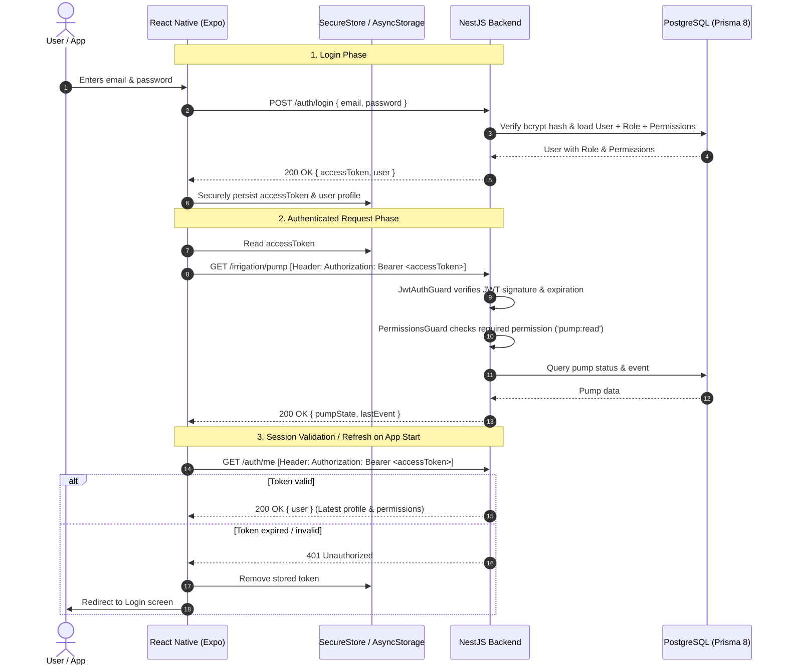

# 📱 Backend Authentication & Authorization (Auth & Authz) Specification
## Mobile App Implementation Guide for AI & Developers

This document serves as the single source of truth for implementing authentication and role/permission-based access control (RBAC & Authz) in the React Native / Expo mobile application (`app/`).

---

## 📌 Table of Contents
1. [Architecture Overview](#1-architecture-overview)
2. [Base URLs & Environment Setup](#2-base-urls--environment-setup)
3. [Authentication Endpoints Specification](#3-authentication-endpoints-specification)
   - [POST /auth/login](#post-authlogin)
   - [POST /auth/register](#post-authregister)
   - [GET /auth/me](#get-authme)
   - [GET /auth/available-permissions](#get-authavailable-permissions)
4. [Authorization Model & Permissions Matrix](#4-authorization-model--permissions-matrix)
5. [Default Seeded Credentials](#5-default-seeded-credentials)
6. [Error Responses & Status Codes](#6-error-responses--status-codes)
7. [Step-by-Step Mobile Implementation Blueprint](#7-step-by-step-mobile-implementation-blueprint)
   - [7.1 Dependencies](#71-dependencies)
   - [7.2 Types Definition (`src/types/auth.ts`)](#72-types-definition)
   - [7.3 Token Storage (`src/services/storage.ts`)](#73-token-storage)
   - [7.4 Authenticated HTTP Client (`src/services/api.ts`)](#74-authenticated-http-client)
   - [7.5 Auth Context & Hook (`src/context/AuthContext.tsx`)](#75-auth-context--hook)
   - [7.6 Expo Router Layout & Protected Routes](#76-expo-router-layout--protected-routes)
   - [7.7 Permission-Aware UI Component (`Can.tsx`)](#77-permission-aware-ui-component)
8. [Checklist for the Implementing AI](#8-checklist-for-the-implementing-ai)

---

## 1. Architecture Overview



- **Protocol**: REST over HTTPS / HTTP.
- **Token Mechanism**: Standard JSON Web Token (JWT) transmitted via HTTP header `Authorization: Bearer <token>`.
- **Token Lifespan**: 7 days.
- **Authorization Guard**: Global NestJS `APP_GUARD` pipeline enforces JWT validation on all endpoints unless explicitly decorated with `@Public()`.

---

## 2. Base URLs & Environment Setup

| Environment | Base URL | Usage |
| :--- | :--- | :--- |
| **Production** | `https://api.riego.pipexapp.com` | Production mobile builds and live server |
| **Local Development** (Android Emulator) | `http://10.0.2.2:3000` | Android emulator loopback to host |
| **Local Development** (iOS Simulator / Web) | `http://localhost:3000` | iOS simulator or web browser |
| **Local Development** (Physical Device) | `http://<YOUR_LAN_IP>:3000` | Phone connected to same Wi-Fi |

> [!TIP]
> Use an environment variable like `process.env.EXPO_PUBLIC_API_URL` with fallback to `https://api.riego.pipexapp.com` so the mobile app can seamlessly toggle between local development and cloud production.

---

## 3. Authentication Endpoints Specification

### `POST /auth/login`
Authenticates user credentials and returns a JWT access token alongside user profile and permission list.

- **Access**: `@Public()` (No authorization header required).
- **Headers**: `Content-Type: application/json`

#### Request Body
```json
{
  "email": "admin@gmail.com",
  "password": "123456"
}
```

#### Success Response (`200 OK`)
```json
{
  "success": true,
  "accessToken": "eyJhbGciOiJIUzI1NiIsInR5cCI6IkpXVCJ9...",
  "user": {
    "id": 1,
    "email": "admin@gmail.com",
    "name": "Administrator",
    "role": "ADMIN",
    "roleId": 1,
    "permissions": [
      "humidity:read",
      "humidity:create",
      "pump:read",
      "pump:control",
      "roles:read",
      "roles:manage",
      "permissions:read",
      "users:read",
      "users:manage"
    ]
  }
}
```

#### Error Response (`401 Unauthorized`)
```json
{
  "statusCode": 401,
  "message": "Invalid credentials",
  "error": "Unauthorized"
}
```

---

### `POST /auth/register`
Self-service registration for new users. Automatically assigns the default `VIEWER` role.

- **Access**: `@Public()`
- **Headers**: `Content-Type: application/json`

#### Request Body
```json
{
  "email": "newuser@example.com",
  "password": "securePassword123",
  "name": "Jane Doe"
}
```

#### Success Response (`201 Created`)
```json
{
  "success": true,
  "accessToken": "eyJhbGciOiJIUzI1NiIsInR5cCI6IkpXVCJ9...",
  "user": {
    "id": 2,
    "email": "newuser@example.com",
    "name": "Jane Doe",
    "role": "VIEWER",
    "roleId": 3,
    "permissions": [
      "humidity:read",
      "pump:read"
    ]
  }
}
```

#### Error Response (`409 Conflict`)
```json
{
  "statusCode": 409,
  "message": "A user with this email already exists",
  "error": "Conflict"
}
```

---

### `GET /auth/me`
Validates the stored JWT token and retrieves fresh user information and up-to-date active permissions directly from the database.

- **Access**: Protected. Requires valid Bearer token.
- **Headers**: `Authorization: Bearer <accessToken>`

#### Success Response (`200 OK`)
```json
{
  "success": true,
  "user": {
    "id": 1,
    "email": "admin@gmail.com",
    "name": "Administrator",
    "roleId": 1,
    "role": "ADMIN",
    "permissions": [
      "humidity:read",
      "humidity:create",
      "pump:read",
      "pump:control",
      "roles:read",
      "roles:manage",
      "permissions:read",
      "users:read",
      "users:manage"
    ]
  }
}
```

#### Error Response (`401 Unauthorized`)
```json
{
  "statusCode": 401,
  "message": "Authentication failed: jwt expired",
  "error": "Unauthorized"
}
```

---

### `GET /auth/available-permissions`
Returns a list of all permission keys recognized by the system. Useful for admin UI screens where custom roles are assembled.

- **Access**: `@Public()`

#### Success Response (`200 OK`)
```json
{
  "success": true,
  "permissions": [
    { "action": "humidity:read", "description": "Read latest humidity, history, and stats" },
    { "action": "humidity:create", "description": "Create humidity sensor readings" },
    { "action": "pump:read", "description": "Read irrigation pump status and history" },
    { "action": "pump:control", "description": "Trigger irrigation pump ON or OFF" },
    { "action": "roles:read", "description": "View system roles and their permissions" },
    { "action": "roles:manage", "description": "Create, modify, and delete custom roles" },
    { "action": "permissions:read", "description": "List all available system permissions" },
    { "action": "users:read", "description": "View user list and user details" },
    { "action": "users:manage", "description": "Create users and change user roles/permissions" }
  ]
}
```

---

## 4. Authorization Model & Permissions Matrix

The backend enforces Role-Based Access Control (RBAC) supplemented by custom granular permissions.

### Rules of Enforcement:
1. **`ADMIN` Role Bypass**: Users with `role: "ADMIN"` automatically pass all permission checks, even for newly added endpoints.
2. **Standard Roles**: Non-admin users must hold the exact permission action associated with the endpoint.
3. **Public Endpoints**: Do not require the `Authorization` header.

### Endpoints vs Permissions Matrix

| Endpoint | Method | Required Permission | Allowed Default Roles | Public? |
| :--- | :---: | :--- | :--- | :---: |
| `/auth/login` | `POST` | *None* | Anyone | **Yes** |
| `/auth/register` | `POST` | *None* | Anyone | **Yes** |
| `/auth/available-permissions` | `GET` | *None* | Anyone | **Yes** |
| `/` (Health check) | `GET` | *None* | Anyone | **Yes** |
| `/auth/me` | `GET` | *Authenticated* | Any logged-in user | No |
| `/humidity/latest` | `GET` | `humidity:read` | `ADMIN`, `OPERATOR`, `VIEWER` | No |
| `/humidity/history` | `GET` | `humidity:read` | `ADMIN`, `OPERATOR`, `VIEWER` | No |
| `/humidity/stats` | `GET` | `humidity:read` | `ADMIN`, `OPERATOR`, `VIEWER` | No |
| `/humidity` | `POST` | `humidity:create` | `ADMIN` | No |
| `/irrigation/pump` | `GET` | `pump:read` | `ADMIN`, `OPERATOR`, `VIEWER` | No |
| `/irrigation/pump` | `POST` | `pump:control` | `ADMIN`, `OPERATOR` | No |
| `/irrigation/status` | `GET` | `pump:read` | `ADMIN`, `OPERATOR`, `VIEWER` | No |
| `/irrigation/threshold` | `PUT` / `POST` | `pump:control` | `ADMIN`, `OPERATOR` | No |
| `/roles` | `GET` | `roles:read` | `ADMIN` | No |
| `/roles` | `POST` | `roles:manage` | `ADMIN` | No |
| `/roles/:id` | `GET` | `roles:read` | `ADMIN` | No |
| `/roles/:id` | `PUT` | `roles:manage` | `ADMIN` | No |
| `/roles/:id` | `DELETE`| `roles:manage` | `ADMIN` | No |
| `/permissions` | `GET` | `permissions:read`| `ADMIN` | No |
| `/users` | `GET` | `users:read` | `ADMIN` | No |
| `/users` | `POST` | `users:manage` | `ADMIN` | No |
| `/users/:id/role` | `PUT` | `users:manage` | `ADMIN` | No |
| `/users/:id/permissions`| `PUT`| `users:manage` | `ADMIN` | No |

---

## 5. Default Seeded Credentials

The database is pre-seeded with an administrator account:

- **Email**: `admin@gmail.com`
- **Password**: `123456`
- **Role**: `ADMIN`
- **Permissions**: Full access to all endpoints.

---

## 6. Error Responses & Status Codes

When an API call fails authentication or authorization, the backend responds with standard NestJS error bodies:

### 1. `401 Unauthorized` (Token missing, malformed, or expired)
```json
{
  "statusCode": 401,
  "message": "Missing or invalid Authorization header. Expected format: Bearer <token>",
  "error": "Unauthorized"
}
```
**Mobile App Action**: Clear stored token and redirect user to `/login`.

### 2. `403 Forbidden` (Token valid, but insufficient permissions)
```json
{
  "statusCode": 403,
  "message": "Forbidden: Insufficient permissions. Missing: pump:control",
  "error": "Forbidden"
}
```
**Mobile App Action**: Display an alert or toast: *"You do not have permission to perform this action."* Do NOT log the user out.

---

## 7. Step-by-Step Mobile Implementation Blueprint

Follow these exact architectural steps to integrate authentication into the Expo app (`app/`).

### Current application implementation

The current app already provides login and self-service registration in the Home screen modal. On iOS and Android it stores the JWT with `expo-secure-store`, validates the saved session with `GET /auth/me` at startup, and clears expired sessions. The web build keeps the token in memory only; it does not persist authentication in browser storage.

The interface uses the permissions returned by the backend to decide whether to show sensor readings and pump controls. Self-service registrations receive the backend's default `VIEWER` role, so they can read status and humidity but cannot manually control the pump. The examples below remain an architectural reference for expanding authentication beyond the current Home screen.

### 7.1 Dependencies
Install `expo-secure-store` for safe persistent storage on iOS/Android. The current web build keeps the session in memory rather than persisting the JWT in browser storage:

```bash
npx expo install expo-secure-store
```

---

### 7.2 Types Definition
Create `app/src/types/auth.ts`:

```typescript
export type PermissionAction =
  | 'humidity:read'
  | 'humidity:create'
  | 'pump:read'
  | 'pump:control'
  | 'roles:read'
  | 'roles:manage'
  | 'permissions:read'
  | 'users:read'
  | 'users:manage';

export type UserRole = 'ADMIN' | 'OPERATOR' | 'VIEWER' | string;

export interface AuthUser {
  id: number;
  email: string;
  name: string | null;
  role: UserRole;
  roleId: number | null;
  permissions: PermissionAction[] | string[];
}

export interface AuthResponse {
  success: boolean;
  accessToken: string;
  user: AuthUser;
}

export interface LoginDto {
  email: string;
  password: string;
}
```

---

### 7.3 Token Storage Helper
Create `app/src/services/storage.ts`:

```typescript
import * as SecureStore from 'expo-secure-store';
import { Platform } from 'react-native';

const TOKEN_KEY = 'riego_auth_token';
const USER_KEY = 'riego_auth_user';

export async function saveAuthData(token: string, user: object): Promise<void> {
  if (Platform.OS === 'web') {
    localStorage.setItem(TOKEN_KEY, token);
    localStorage.setItem(USER_KEY, JSON.stringify(user));
    return;
  }
  await SecureStore.setItemAsync(TOKEN_KEY, token);
  await SecureStore.setItemAsync(USER_KEY, JSON.stringify(user));
}

export async function getAuthToken(): Promise<string | null> {
  if (Platform.OS === 'web') {
    return localStorage.getItem(TOKEN_KEY);
  }
  return SecureStore.getItemAsync(TOKEN_KEY);
}

export async function getAuthUser<T>(): Promise<T | null> {
  let json: string | null = null;
  if (Platform.OS === 'web') {
    json = localStorage.getItem(USER_KEY);
  } else {
    json = await SecureStore.getItemAsync(USER_KEY);
  }
  return json ? JSON.parse(json) : null;
}

export async function clearAuthData(): Promise<void> {
  if (Platform.OS === 'web') {
    localStorage.removeItem(TOKEN_KEY);
    localStorage.removeItem(USER_KEY);
    return;
  }
  await SecureStore.deleteItemAsync(TOKEN_KEY);
  await SecureStore.deleteItemAsync(USER_KEY);
}
```

---

### 7.4 Authenticated HTTP Client
Create `app/src/services/api.ts`:

```typescript
import { getAuthToken, clearAuthData } from './storage';

export const API_BASE_URL =
  process.env.EXPO_PUBLIC_API_URL || 'https://api.riego.pipexapp.com';

export interface ApiFetchOptions extends RequestInit {
  requiresAuth?: boolean;
}

export async function apiFetch<T>(
  endpoint: string,
  options: ApiFetchOptions = {},
): Promise<T> {
  const { requiresAuth = true, headers = {}, ...rest } = options;

  const requestHeaders: Record<string, string> = {
    'Content-Type': 'application/json',
    ...(headers as Record<string, string>),
  };

  if (requiresAuth) {
    const token = await getAuthToken();
    if (token) {
      requestHeaders['Authorization'] = `Bearer ${token}`;
    }
  }

  const url = endpoint.startsWith('http') ? endpoint : `${API_BASE_URL}${endpoint}`;
  const response = await fetch(url, {
    ...rest,
    headers: requestHeaders,
  });

  if (response.status === 401 && requiresAuth) {
    await clearAuthData();
    throw new Error('SESSION_EXPIRED');
  }

  const data = await response.json().catch(() => null);

  if (!response.ok) {
    const message = data?.message || `Request failed with status ${response.status}`;
    throw new Error(Array.isArray(message) ? message.join(', ') : message);
  }

  return data as T;
}
```

---

### 7.5 Auth Context & Hook
Create `app/src/context/AuthContext.tsx`:

```typescript
import React, { createContext, useContext, useEffect, useState, useCallback } from 'react';
import { AuthUser, LoginDto, AuthResponse, PermissionAction } from '../types/auth';
import { apiFetch } from '../services/api';
import { saveAuthData, getAuthToken, getAuthUser, clearAuthData } from '../services/storage';

interface AuthContextType {
  user: AuthUser | null;
  token: string | null;
  isLoading: boolean;
  login: (dto: LoginDto) => Promise<void>;
  logout: () => Promise<void>;
  hasPermission: (permission: PermissionAction) => boolean;
  hasRole: (role: string) => boolean;
}

const AuthContext = createContext<AuthContextType | undefined>(undefined);

export function AuthProvider({ children }: { children: React.ReactNode }) {
  const [user, setUser] = useState<AuthUser | null>(null);
  const [token, setToken] = useState<string | null>(null);
  const [isLoading, setIsLoading] = useState(true);

  // Initialize and validate session on app startup
  useEffect(() => {
    async function initAuth() {
      try {
        const storedToken = await getAuthToken();
        const storedUser = await getAuthUser<AuthUser>();

        if (storedToken && storedUser) {
          setToken(storedToken);
          setUser(storedUser);

          // Verify token against backend
          try {
            const res = await apiFetch<{ success: boolean; user: AuthUser }>('/auth/me');
            if (res.user) {
              setUser(res.user);
              await saveAuthData(storedToken, res.user);
            }
          } catch (err: any) {
            if (err.message === 'SESSION_EXPIRED') {
              setUser(null);
              setToken(null);
            }
          }
        }
      } finally {
        setIsLoading(false);
      }
    }

    initAuth();
  }, []);

  const login = useCallback(async (dto: LoginDto) => {
    const res = await apiFetch<AuthResponse>('/auth/login', {
      method: 'POST',
      body: JSON.stringify(dto),
      requiresAuth: false,
    });

    setToken(res.accessToken);
    setUser(res.user);
    await saveAuthData(res.accessToken, res.user);
  }, []);

  const logout = useCallback(async () => {
    await clearAuthData();
    setToken(null);
    setUser(null);
  }, []);

  // Check if current user has permission (ADMIN bypass included)
  const hasPermission = useCallback(
    (permission: PermissionAction): boolean => {
      if (!user) return false;
      if (user.role === 'ADMIN') return true;
      return user.permissions?.includes(permission) ?? false;
    },
    [user],
  );

  const hasRole = useCallback(
    (role: string): boolean => {
      if (!user) return false;
      return user.role === role.toUpperCase();
    },
    [user],
  );

  return (
    <AuthContext.Provider
      value={{
        user,
        token,
        isLoading,
        login,
        logout,
        hasPermission,
        hasRole,
      }}
    >
      {children}
    </AuthContext.Provider>
  );
}

export function useAuth() {
  const context = useContext(AuthContext);
  if (!context) {
    throw new Error('useAuth must be used within an AuthProvider');
  }
  return context;
}
```

---

### 7.6 Expo Router Layout & Protected Routes
In `app/src/app/_layout.tsx`:

```tsx
import { DarkTheme, DefaultTheme, ThemeProvider } from '@react-navigation/native';
import { Stack, useRouter, useSegments } from 'expo-router';
import { useEffect } from 'react';
import { useColorScheme, ActivityIndicator, View } from 'react-native';
import { AuthProvider, useAuth } from '@/context/AuthContext';

function RootLayoutNav() {
  const { user, isLoading } = useAuth();
  const segments = useSegments();
  const router = useRouter();
  const colorScheme = useColorScheme();

  useEffect(() => {
    if (isLoading) return;

    const inAuthGroup = segments[0] === '(auth)';

    if (!user && !inAuthGroup) {
      // Redirect to login if user is not authenticated
      router.replace('/(auth)/login');
    } else if (user && inAuthGroup) {
      // Redirect to home if user is already logged in
      router.replace('/');
    }
  }, [user, isLoading, segments, router]);

  if (isLoading) {
    return (
      <View style={{ flex: 1, justifyContent: 'center', alignItems: 'center' }}>
        <ActivityIndicator size="large" color="#1FA7B5" />
      </View>
    );
  }

  return (
    <ThemeProvider value={colorScheme === 'dark' ? DarkTheme : DefaultTheme}>
      <Stack screenOptions={{ headerShown: false }}>
        <Stack.Screen name="index" />
        <Stack.Screen name="(auth)/login" options={{ presentation: 'modal' }} />
      </Stack>
    </ThemeProvider>
  );
}

export default function RootLayout() {
  return (
    <AuthProvider>
      <RootLayoutNav />
    </AuthProvider>
  );
}
```

---

### 7.7 Permission-Aware UI Component (`Can.tsx`)
Create `app/src/components/Can.tsx` to conditionally render UI controls based on permissions:

```tsx
import React from 'react';
import { useAuth } from '@/context/AuthContext';
import { PermissionAction } from '@/types/auth';

interface CanProps {
  permission: PermissionAction;
  children: React.ReactNode;
  fallback?: React.ReactNode;
}

/**
 * Conditionally renders children if current user has the required permission.
 * Admins automatically bypass all checks.
 */
export function Can({ permission, children, fallback = null }: CanProps) {
  const { hasPermission } = useAuth();

  if (hasPermission(permission)) {
    return <>{children}</>;
  }

  return <>{fallback}</>;
}
```

#### Usage in Pump Control Screen:
```tsx
import { Can } from '@/components/Can';

<Can
  permission="pump:control"
  fallback={<Text style={{ color: '#888' }}>Solo operadores pueden encender la bomba</Text>}
>
  <Pressable onPress={() => handleTogglePump('ON')}>
    <Text>Encender Bomba</Text>
  </Pressable>
</Can>
```

---

## 8. Checklist for the Implementing AI

When implementing the mobile authentication logic:

- [ ] Install `expo-secure-store` using `npx expo install expo-secure-store`.
- [ ] Implement `src/types/auth.ts`, `src/services/storage.ts`, and `src/services/api.ts`.
- [ ] Create `AuthContext` to expose `user`, `login`, `logout`, and `hasPermission`.
- [ ] Wrap root layout `_layout.tsx` with `<AuthProvider>`.
- [ ] Verify that `GET /irrigation/pump` and `POST /irrigation/pump` include the `Authorization: Bearer <token>` header.
- [ ] Use `Can` or `hasPermission('pump:control')` to disable or hide pump action buttons for users with read-only roles (`VIEWER`).
- [ ] Handle `401 Unauthorized` responses gracefully by clearing state and opening the login view.
- [ ] Pre-fill or test login using:
  - **Email**: `admin@gmail.com`
  - **Password**: `123456`
